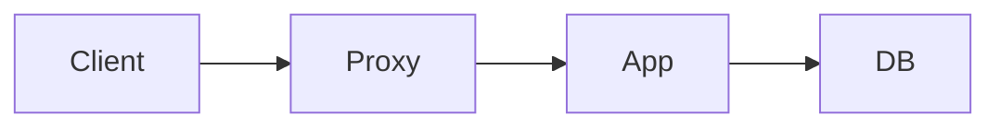
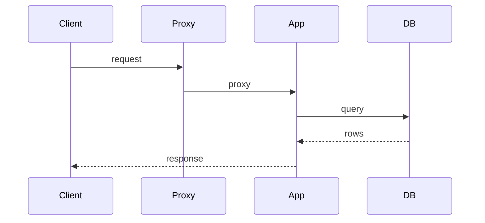
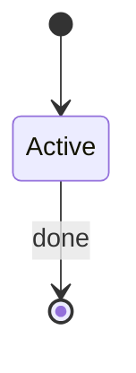

# 目的

初期実装の構成、リクエスト経路、データの流れをソースから確認し、以後の改善判断の前提にする。

# 前提条件

- `initialize-servers.md` でアプリケーションソースが Git 管理されている。
- 実行中の配置は `check-environment.md` の記録を使う。推測でサーバー役割を決めない。
- このタスクではアプリケーションや設定を変更しない。
- 図はソースと実機確認に基づく。公開解答や未確認の過去問構成を描かない。
- 問題固有のパス、テーブル名、外部 API は、ソースまたはマニュアルで確認してから Issue に書く。

# 対象サーバー

なし。分析はローカルの Git 作業ツリーで行う。実行配置の確認が足りない項目だけ、`check-environment.md` の対象サーバーを見る。

# 作業

- 追跡しているアプリケーションソースの範囲を確定する。
- プロセス、ストレージ、外部連携、主要リクエスト経路、状態遷移を事実として抜き出す。
- [Archify](https://github.com/tt-a1i/archify) で architecture、workflow、sequence、dataflow、lifecycle のレポートを出す。
- 重要な点を文章と簡単な mermaid 図として Issue に書く。
- Archify の HTML と PNG を Issue に添付する。
- 改善案は仮説と分け、このタスクでは変更しない。

## 実行例

コマンドは実行例である。問題や環境によって構成、パス、サービス名、言語、接続方法は異なる。Issue に記録したユーザー提供情報と実機の状態に合わせて読み替える。

```bash
mkdir -p /tmp/isucon-work/architecture
ARCHIFY= # bin/archify.mjs がある Archify Skill のルート
test -f "$ARCHIFY/bin/archify.mjs"
```

未導入なら https://github.com/tt-a1i/archify の手順で Skill を入れる。JSON の作成、validate、deliver は Skill の手順に従う。

## 1. 分析対象のソース範囲を確定する

```bash
git ls-files | grep -E 'home/isucon|webapp|app/' | head
```

エントリポイント、ルーティング、DB アクセス、外部呼び出しの場所を確認する。パスは `git ls-files` の結果だけ使う。

## 2. 構成の事実を抜き出す

ソースと `check-environment.md` の記録から、次を事実として書き出す。無いものは「なし」または「未確認」と書く。

- プロセス構成（プロキシ、アプリ、DB、キャッシュ、キュー）
- 言語、エントリポイント、同期モデル（同期 / 非同期）
- 1 リクエストが触るストレージと外部 API
- 初期化処理の有無と内容
- 認証・セッションの持ち方
- 状態を持つエンティティと遷移

推測は仮説として分け、図のノードにしない。

## 3. Archify でレポートを出す

図はソース根拠のあるノードだけにする。主経路を 1 本に保ち、主要ノードは 12 以下にする。`meta.quality_profile` は `"showcase"` にする。著者言語は日本語。Viewer UI の `meta.locale` は付けず、英語 UI にフォールバックする旨を Issue に書く。

対象と用途は次のとおり。根拠が無ければその種類は作らず、理由を Issue に書く。

| 種類 | 用途 |
| --- | --- |
| architecture | コンポーネント、境界、実行時の接続 |
| workflow | 初期化や代表的な処理の手順 |
| sequence | 代表リクエストの呼び出し順と戻り |
| dataflow | 読み書きの経路と保存先 |
| lifecycle | エンティティの状態遷移。状態が無ければ省略 |

JSON を書いたら、種類ごとに validate してから deliver する。失敗した HTML を成功扱いにしない。

```bash
cd "$ARCHIFY"
for t in architecture workflow sequence dataflow lifecycle; do
  src="/tmp/isucon-work/architecture/${t}.json"
  out="/tmp/isucon-work/architecture/${t}.html"
  [ -f "$src" ] || continue
  node bin/archify.mjs validate "$t" "$src" --quality showcase --json
  node bin/archify.mjs deliver "$t" "$src" "$out" --quality showcase --json
done
```

PNG は Viewer の Export、または visual-check のスクリーンショットを `/tmp/isucon-work/architecture/` に置く。

```bash
cd "$ARCHIFY"
for html in /tmp/isucon-work/architecture/*.html; do
  [ -f "$html" ] || continue
  node bin/archify.mjs visual-check "$html" --json
done
```

## 4. 重要な点を文章と mermaid で Issue に書く

Archify の詳細図は添付にする。Issue 本文には、以後の改善判断に使う点だけを短く書く。mermaid は確認した名前に置き換える。未確認のノードを足さない。コメント原稿は `/tmp/isucon-work/architecture/issue-comment.md` に置く。

````markdown
## 参照

- ソース範囲:
- 確認した commit:
- Archify: https://github.com/tt-a1i/archify
- Viewer UI は英語にフォールバックする。図のラベルは日本語。

## 事実

- プロセス構成:
- エントリポイント:
- 1 リクエストが触るストレージ / 外部 API:
- 初期化処理:
- 認証・セッション:
- 状態を持つエンティティ:

## 重要な点

-

## 構成



## 代表リクエスト



## 状態遷移

状態が無い場合は「なし」と書く。



## 仮説（このタスクでは変更しない）

-

## 成果物

- `/tmp/isucon-work/architecture/*.html`
- `/tmp/isucon-work/architecture/*.json`
- 省略した図の種類と理由:
````

```bash
gh issue comment "$ISSUE" --body-file /tmp/isucon-work/architecture/issue-comment.md
```

## 5. レポートを Issue に添付する

HTML と JSON は Issue コメントへの添付対象である。GitHub CLI の `--attach` は画像・動画のみなので、HTML と JSON は Issue 画面にドロップする。PNG は `--attach` があれば使い、無ければ同様にドロップする。

```bash
ls -l /tmp/isucon-work/architecture
zip -j /tmp/isucon-work/architecture/archify-reports.zip /tmp/isucon-work/architecture/*.html /tmp/isucon-work/architecture/*.json

# --attach がある gh なら PNG をコメントに埋め込む
gh issue comment "$ISSUE" --body "Archify レポートの PNG" \
  --attach /tmp/isucon-work/architecture/architecture.png#architecture \
  --attach /tmp/isucon-work/architecture/workflow.png#workflow \
  --attach /tmp/isucon-work/architecture/sequence.png#sequence \
  --attach /tmp/isucon-work/architecture/dataflow.png#dataflow \
  --attach /tmp/isucon-work/architecture/lifecycle.png#lifecycle
```

`--attach` が使えない、または一部の PNG が無い場合は、Issue コメント欄へ次をドロップする。

- `/tmp/isucon-work/architecture/*.html`
- `/tmp/isucon-work/architecture/*.json`
- `/tmp/isucon-work/architecture/*.png`
- `/tmp/isucon-work/architecture/archify-reports.zip`

添付後、コメントから HTML と PNG を辿れることを確認する。HTML は GitHub 上では実行されない。閲覧はダウンロードしてローカルで開く。

# 確認方法

```bash
ls -l /tmp/isucon-work/architecture
gh issue view "$ISSUE" --comments
```

Issue に事実と仮説が分かれて書かれ、重要な点の mermaid があり、Archify の HTML または zip が添付されていること。

# 失敗時の復旧

- Archify が無い: Skill を入れてから図を出す。図が出せなくても、事実の箇条書きと mermaid は Issue に書く。
- validate / deliver が失敗する: 根拠の無いノードを足さず、主経路を減らしてから再実行する。失敗 HTML を添付しない。
- 種類の根拠が無い: その図は作らず、省略理由を Issue に書く。
- `--attach` が無い: Issue 画面へのドロップで HTML、JSON、PNG、zip を添付する。
- ソース範囲が不明: `initialize-servers.md` の追跡対象を確認する。未追跡のバイナリやデータは分析対象にしない。

# 完了条件

- ソースに基づく構成の事実が Issue にある。
- 重要な点が文章と mermaid で読める。
- Archify の HTML レポートが Issue に添付されている。省略した種類には理由がある。
- 推測と改善案が仮説として分かれている。
- このタスクでアプリケーションや設定を変更していない。

