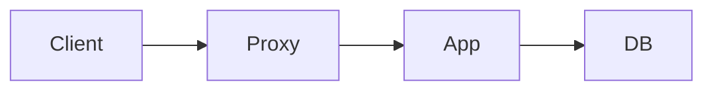
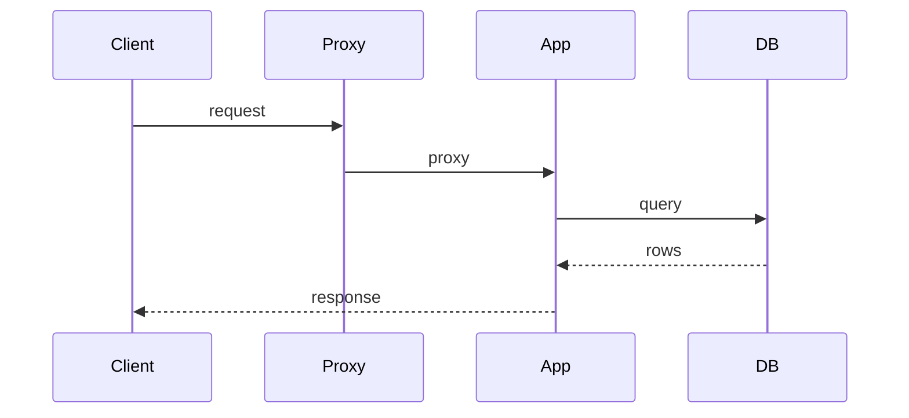
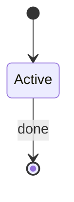

# 目的

初期実装の構成、リクエスト経路、データの流れをソースから確認し、以後の改善判断の前提にする。

# 前提条件

- `initialize-servers.md` でアプリケーションソースが Git 管理されている。
- 実行中の配置は確認済みの情報を使い、未確認の項目は未確認とする。推測でサーバー役割を決めない。
- このタスクではアプリケーションや設定を変更しない。
- 図はソースと実機確認に基づく。公開解答や未確認の過去問構成を描かない。
- 問題固有のパス、テーブル名、外部 API は、ソースまたはマニュアルで確認してから Issue に書く。

# 対象サーバー

なし。分析はローカルの Git 作業ツリーで行う。実行配置の確認が必要な項目だけ、対象サーバーを見る。

# 作業

- 追跡しているアプリケーションソースの範囲を確定する。
- プロセス、ストレージ、外部連携、主要リクエスト経路、状態遷移を事実として抜き出す。
- [Archify](https://github.com/tt-a1i/archify) で architecture、workflow、sequence、dataflow、lifecycle のレポートを出す。
- 重要な点を文章と簡単な mermaid 図として Issue に書く。
- Archify の SVG 5種のみを Issue に添付し、リンクを確認する。
- 改善案は仮説と分け、このタスクでは変更しない。

## 実行例

コマンドは実行例である。問題や環境によって構成、パス、サービス名、言語、接続方法は異なる。Issue に記録したユーザー提供情報と実機の状態に合わせて読み替える。

```bash
mkdir -p /tmp/isucon-work/architecture
ARCHIFY= # bin/archify.mjs がある Archify Skill のルート
test -f "$ARCHIFY/bin/archify.mjs"
```

未導入なら https://github.com/tt-a1i/archify の手順で Skill を入れる。作成・検証・出力は導入版の Skill の手順に従う。

## 1. 分析対象のソース範囲を確定する

```bash
git ls-files | grep -E 'home/isucon|webapp|app/' | head
```

エントリポイント、ルーティング、DB アクセス、外部呼び出しの場所を確認する。パスは `git ls-files` の結果だけ使う。

## 2. 構成の事実を抜き出す

ソースと確認済みの環境情報から、次を事実として書き出す。無いものは「なし」または「未確認」と書く。

- プロセス構成（プロキシ、アプリ、DB、キャッシュ、キュー）
- 言語、エントリポイント、同期モデル（同期 / 非同期）
- 1 リクエストが触るストレージと外部 API
- 初期化処理の有無と内容
- 認証・セッションの持ち方
- 状態を持つエンティティと遷移

推測は仮説として分け、図のノードにしない。

## 3. Archify で5種の SVG を作る

開始前に Archify と Node >=18 の利用可否を確認し、未導入なら公式手順に従って導入する。導入版の SKILL.md を正とし、版・検証 receipt を一時領域に保存する。古い validate / deliver 等のコマンドを版確認なしに固定しない。

architecture / workflow / sequence / dataflow / lifecycle をソース根拠に基づいて作成し、導入版の検証・表示確認を通す。根拠がない種類は推測で補わず、理由を Issue に書く。

Viewer の正規 Export → SVG Auto で native vector を出力する。XML parse、text/path、viewBox を確認し、PNG/JPEG を包んだ SVG にしない。HTML / JSON / PNG / receipt は内部検証用として一時領域に生成してよい。

## 4. 重要な点を文章と mermaid で Issue に書く

Archify の詳細図は添付にする。Issue 本文には、以後の改善判断に使う点だけを短く書く。mermaid は確認した名前に置き換える。未確認のノードを足さない。コメント原稿は `/tmp/isucon-work/architecture/issue-comment.md` に置く。

````markdown
## 参照

- ソース範囲:
- 確認した commit:
- Archify: https://github.com/tt-a1i/archify
- Viewer UI は英語にフォールバックする。図のラベルは日本語。

## 事実

- プロセス構成:
- エントリポイント:
- 1 リクエストが触るストレージ / 外部 API:
- 初期化処理:
- 認証・セッション:
- 状態を持つエンティティ:

## 重要な点

-

## 構成



## 代表リクエスト



## 状態遷移

状態が無い場合は「なし」と書く。



## 仮説（このタスクでは変更しない）

-

## 成果物

- `/tmp/isucon-work/architecture/*.html`
- `/tmp/isucon-work/architecture/*.json`
- 省略した図の種類と理由:
````

```bash
gh issue comment "$ISSUE" --body-file /tmp/isucon-work/architecture/issue-comment.md
```

## 5. SVG を Issue に添付する

添付対象は architecture / workflow / sequence / dataflow / lifecycle の SVG 5種のみ。HTML / JSON / PNG / ZIP は添付せず、ZIP 作成も要求しない。

利用する gh の help で添付機能・形式の対応を確認する。CLI が SVG を受理しない場合は Issue UI から添付し、ユーザー操作が必要なら `needs-user-action` を付ける。添付リンクを確認するまでは未完了にする。

# 確認方法

- 各 SVG を XML として読み込み、viewBox と vector 要素、ラスター埋込なしを確認する。
- Issue の5種のリンクを辿れることを確認する。根拠がない種類は省略理由を確認する。

# 失敗時の復旧

- Archify / Node がない: 公式の導入手順と利用版を確認する。
- 検証失敗: 根拠のない要素を足さず修正し、失敗した成果物を添付しない。
- 添付不可: UI で添付し、完了報告とリンク確認までは未完了にする。
- ソース範囲が不明: 追跡対象と確認 commit を再確認する。

# 完了条件

- ソースに基づく事実と、推測・改善案が Issue で区別されている。
- 重要な点が文章と mermaid で読める。
- SVG 5種の添付リンクを確認済み。根拠がなく省略した種類には理由がある。
- アプリケーションや設定を変更していない。
